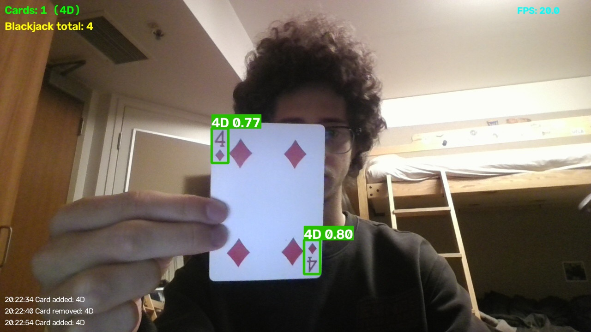
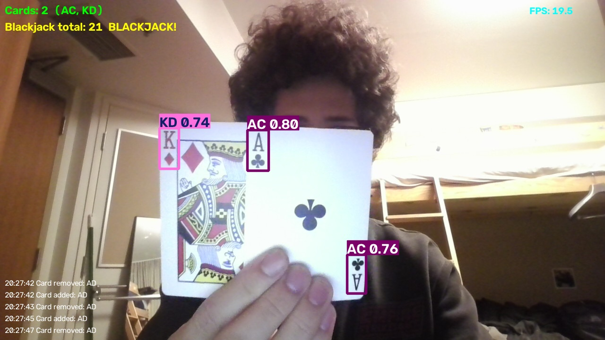
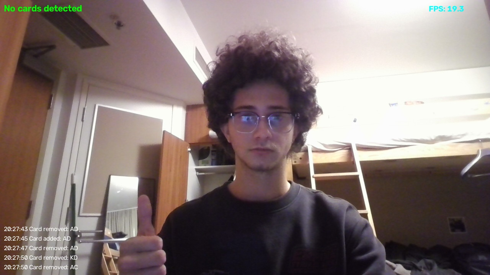

# Playing Card Detector with Blackjack Total

A program that detects playing cards on a live webcam feed, adds up their blackjack value, and logs when cards appear or leave.

## Sample output

| One card | Blackjack total | No cards |
|---|---|---|
|  |  |  |

## What it detects

All 52 playing cards, each identified by rank and suit (for example `7H` or `KS`), from a live webcam feed.

## Model

I used **YOLO11n** (from [Ultralytics](https://github.com/ultralytics/ultralytics)) and fine-tuned it on the [Augmented Startups Playing Cards dataset](https://universe.roboflow.com/augmented-startups/playing-cards-ow27d) from Roboflow Universe. I chose it because:

- YOLO gives boxes and labels in one pass, which suits live video.
- The nano size runs at about 20 FPS on my laptop.
- A stock model doesn't know playing cards, so fine-tuning was needed.

Training ran for about one hour on a free Google Colab GPU (9 epochs). It scored mAP50 0.995 on the dataset's validation images, but those images are similar to the training images, so this is higher than real webcam accuracy.

## How it works

For each webcam frame, the program:

1. Runs the model and draws labeled boxes.
2. Collects the unique card labels. Each card has two corner indices that the model can detect separately, so duplicate labels are counted as one card.
3. Tracks which cards are on the table (see below) and computes the blackjack total.
4. Shows the card count, total, and recent events on screen.

If no cards are detected, it shows "No cards detected" and keeps running.

## Custom behavior

- **Stable tracking:** a card must be seen in 2 frames in a row before it counts, and it stays counted for 1 second after it was last seen. This stops flickering detections from changing the count.
- **Blackjack total:** number cards are worth their number, J/Q/K are worth 10, and an ace is 11 (or 1 if 11 would go over 21). The screen shows BLACKJACK! for a two-card 21, 21! for a longer hand that totals 21, and BUST over 21.
- **Event log:** messages like `Card added: KS` and `Card removed: KS` appear on screen and in the console.

## Install and run

Tested with Python 3.11 on Windows.

```bash
git clone https://github.com/YOUR-USERNAME/YOUR-REPO-NAME.git
cd YOUR-REPO-NAME
python -m venv venv
venv\Scripts\activate
pip install -r requirements.txt
python detect_cards.py
```

Click the camera window, then press `q` to quit or `s` to save a screenshot to `samples/`. The trained weights (`best.pt`) are included. If the video is laggy, set `IMG_SIZE = 640` at the top of `detect_cards.py`.

## Limitations

- The training images are synthetic, so on a real webcam cards need to be held steady, fully in view, and well lit.
- Accuracy varies by card, and I didn't test all 52 systematically.
- Identical cards (such as from two decks) count as one.
- All visible cards are scored as a single blackjack hand, with no dealer or player split.
- A misread card changes the total.

## Possible improvements

- Train on real photos of cards, with blur and glare added to the training data.
- Train longer or use a larger model.
- Use object tracking so each physical card has its own ID.
- Separate player and dealer hands.
